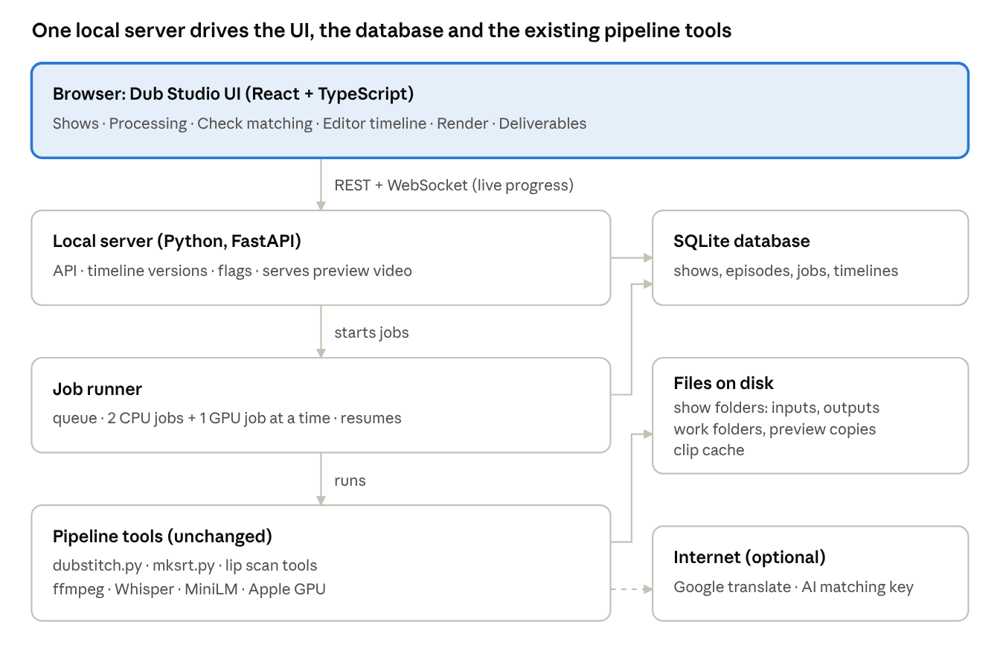
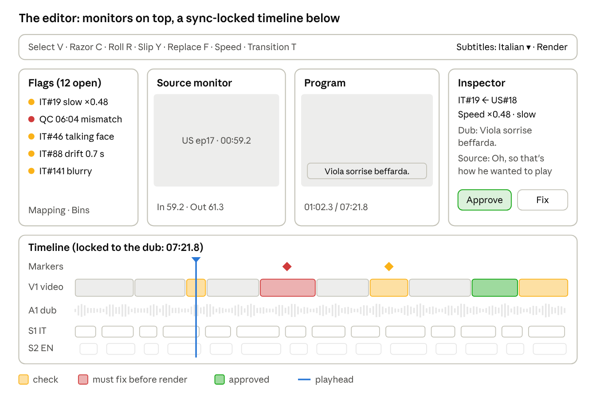

# Dub Studio — local platform design

Oct 15, 2026 · owner: Sameer · status: **approved** (all recommendations in "Decisions" were accepted)

Source: the Claude Doc "Dub Studio — local platform design" (exported here; the two drawings are in `docs/img/`).

## The answer

The platform runs fully on Sameer's Mac with a local database and no login. It wraps the pipeline that
already runs (`dubstitch.py` and the lip and SRT tools) in a local web app, called **Dub Studio**.

The core idea: after processing, nothing is rendered. The episode opens as a **timeline of clips** in a
Premiere-style editor. Every clip is a pointer into the source video (in-point, out-point, speed), played live
from a light preview copy. Clips we are unsure about are coloured yellow or red. The editor fixes them, and only
then renders the final three videos.

The pipeline stays the single source of truth for matching and rendering. The editor only changes the **edit
list**, the same list `render` already turns into a video.

## The journey, as a user and an editor

One episode goes through eight stages; the editor only works in stages 5 to 7.

1. **Create a show** (once). Pick a preset (TDMB, TOLR, WBM or New) that fills the show profile: languages, lip
   scan on/off, clause mode, group size, transitions, subtitle style, ending on/off, file naming. Point it at the
   show folder on disk.
2. **Create an episode.** Enter the number. The app scans the show folder and pre-fills the files it finds for
   that number: source video, dub audio, SRTs, scripts, name list. You confirm or drag in other files. It checks
   each file (length, language, matching numbers) before you can start.
3. **Process.** One click. A live progress page shows every step with a bar, time used, time left, and the last
   log lines: make SRTs, sentence times, matching, lip scan, edit list, groups, preview files. Steps run in
   parallel where they can.
4. **Check the matching** (only when needed). Rows the tool could not decide on its own are listed with the source
   sentence it suggests and the top 5 alternatives. The editor picks one, or marks a real gap. Matching by meaning
   with the AI can do this step if a key is set.
5. **Open the editor.** The whole episode appears as a timeline: dub audio, video clips, Italian and English
   subtitles. Nothing has been rendered yet. Yellow and red clips are the ones to check.
6. **Review and edit.** Play, jump flag to flag, approve good clips, and fix bad ones: slip footage, move a cut,
   replace a clip from the source, change speed, delete, add your own clip, edit subtitles. Every change saves as
   a new version you can go back to.
7. **Render.** When no red flags are left, render. The app builds the clean video, the Italian-subtitle video and
   the English-subtitle video, runs the final check, and reuses every clip that did not change.
8. **Deliver.** A page lists the outputs, the check result and the mapping sheet, with buttons to open them in
   Finder. A QC note that comes back later ("01:02 Viola smiling") is typed in as a marker and the episode goes
   back to step 6.

## Architecture and stack

One Python server on the Mac runs the app. The browser is only the screen, and the existing tools are called as
they are.

The job runner reports progress to the database and the server pushes it to the browser; tools read and write
the show and work folders. The internet is used only for translation and the optional AI matching.

| Part | Choice | Why |
| --- | --- | --- |
| Server | Python 3 + FastAPI | the pipeline is Python, so jobs call it directly |
| Database | SQLite in WAL mode | one local file, no server to install, safe with a UI and workers writing at once |
| Jobs | a small runner in the same app, its queue in SQLite | no Redis or Docker; survives restarts |
| Live updates | WebSocket | progress bars and log lines appear as they happen |
| UI | React + TypeScript (Vite) | a custom timeline needs fine control of drawing and keys |
| Timeline drawing | canvas for clips and waveforms, HTML for panels | smooth at 300+ clips and deep zoom |
| Editor state | one store with an undo stack of edit commands | unlimited undo, and every command is also checked against the sync rule |
| Video | ffmpeg for proxies, thumbnails, waveforms, render | already used by every step |
| Start | one command (or a double-click launcher) that starts the server and opens the browser | no setup each day |

## Data model (SQLite, one file per library)

Everything lives in one SQLite file plus a media folder; the timeline itself is one JSON document per saved version.

| Table | What it holds | Key fields |
| --- | --- | --- |
| shows | one row per show | name, folder, profile (JSON: languages, lip, clauses, group size, transitions, subtitle style, ending, naming) |
| episodes | one row per episode | show, number, status, current timeline version, work folder |
| assets | every input and derived file | episode, kind (source video, dub audio, SRT, script, proxy, thumbnails, waveform, user clip), path, size, fingerprint, duration, fps, width × height |
| jobs | every step run | episode, step, status, progress %, current item, started, finished, log file, parameters, attempt |
| sentences | the timed units of both sides | episode, side, index, text, start, end, lip seconds, speaking |
| mapping | each dub row's decision | dub row, source first/last, kind (auto, assign, group, repeat, gap), reason, score, decided by (tool, AI, editor) |
| timeline_versions | the edit list, every save | episode, version, parent, made by (pipeline or editor), note, JSON body |
| flags | why a clip is yellow or red | episode, version, clip id, kind, severity, message, status (open, ok, fixed) |
| markers | QC notes and editor notes | episode, time, text, source (QC, editor), resolved |
| subtitle_tracks | one per language | episode, language, kind (dub, translation), cues JSON, style JSON |
| renders | every render | episode, timeline version, outputs, status, check result, paths |
| settings | app settings | ffmpeg path, workers, GPU, translation engine, keys (stored locally) |

**The timeline JSON** (one per version) is the heart of the editor. Each clip carries:

- **Placement:** id, track, timeline in and out (ms), lock.
- **Footage:** source asset, source in and out (ms). The speed follows from the two lengths; it can also be set by hand.
- **Meaning:** type (group, lip row, single, opening, ending, user clip, filler), the dub rows and source sentences
  it covers, transition at its start.
- **Review:** flag ids, review state (unreviewed, approved, changed), note.

The pipeline writes version 1 from `manifest_groups.json`. Render reads any version back and writes the same
`manifest_groups.json` format, so the existing render, verify and subtitle commands work unchanged.
(Formats: see `04_PIPELINE_REFERENCE.md`; real examples in `examples/`.)

## Processing services

Each pipeline step becomes a job that the job runner starts once its inputs are ready. Every job reports
progress events (step, percent, current item, message) that the UI shows live.

| Job | What it does | Needs | Runs on | Notes |
| --- | --- | --- | --- | --- |
| ingest | probe each file (length, fps, size), fingerprint it, check languages and episode numbers | uploads | CPU | files stay where they are; the app stores path + fingerprint and marks the episode stale if a file changes |
| proxy | a 540-px preview copy of the source with a keyframe every 0.5 s, plus 1-frame-per-second thumbnail strips and audio waveforms | ingest | CPU | makes scrubbing and clip switching instant in the editor |
| scene cuts | finds every camera cut in the source | ingest | CPU | used for snapping, bleed flags and transitions |
| make SRTs (Step 0B) | Whisper + script cleaning, per side | ingest, only if an SRT is missing | CPU / Apple GPU | both sides run at the same time |
| words (1A) | exact times for every sentence or clause | SRTs | CPU | both sides at the same time |
| analyze (1B) | automatic matching | words | CPU | writes the rows to check |
| match by meaning (2) | decides every flagged row | analyze | Claude via the AI gateway, or the editor | with no key: the editor decides on the Check matching screen |
| sheet + manifest (3-4) | integrity check, mapping sheet, row-level edit list | decisions | CPU | stops with a clear message if two rows share footage |
| lip scan (4B) | moving mouths in the source | ingest | Apple GPU + CPU | starts at upload, in parallel with steps 1A-4; TOLR-type shows only |
| lipsync + groups (4A) | lip rows, groups, drift limits | manifest, lip scan | CPU | |
| build timeline | writes timeline version 1 + all flags | groups, scene cuts | CPU | the episode becomes Ready for review |
| translate | English subtitle track | dub SRT | network | Google; when blocked, the AI or a pasted file |
| render | final videos from a chosen timeline version | timeline, subtitles | CPU | see "Preview and render" |

**Live progress.** Each job writes events to the database. The server pushes them to the browser over a
WebSocket. Each step shows its bar, ETA from the measured speed, the last 20 log lines and a Cancel button. A
failed step shows its error and Retry. Because every tool already resumes where it stopped (exit code 3 = "run
me again"), Retry and a restart after the Mac sleeps both continue rather than start over.

**Parallel work on one Mac.** The runner caps CPU-heavy jobs at 2 at a time and GPU jobs at 1, with the safety
limits the lip scan already has. Several episodes can be queued; they run in order.

**Re-running a step after edits.** If the editor has changed the timeline and a pipeline step is re-run, the app
makes a new pipeline version instead of overwriting. It then offers a per-clip merge: keep my edit, or take the
new one.

## The editor

The dub audio is fixed, so the editor is built around one rule: **the timeline is always exactly as long as the
dub, and no edit may leave a hole.** Premiere's ripple edits would push the picture out of sync, so the main tools
here are overwrite, slip, roll and replace.

**Tracks, top to bottom**

- **Markers:** QC notes, editor notes, flags.
- **V1, video clips:** each block shows a thumbnail strip, a short label (`IT#19 ← DE#16`), a speed badge
  (`×0.62`), a lip icon for lip rows, and its flag colour.
- **V2, overlay:** the editor's own uploaded clips and stills, laid over V1 for gaps where no source footage exists.
- **A1, dub audio:** waveform, locked.
- **A2, source sound:** muted by default, for reference only.
- **S1, dub subtitles; S2, English subtitles:** editable cues.
- **Text lane:** dub sentences on top, the matched source sentences under them.

**Editing tools**

| Tool | Key | What it does here |
| --- | --- | --- |
| Select / move | V | select one or many clips; drag a clip to another slot = overwrite (the slot it leaves is filled, see below) |
| Razor | C | cut a clip in two at the playhead (for example to put a different shot on half a line) |
| Trim | drag an edge | lengthen or shorten a clip into its neighbour; the neighbour gives up or takes the time, so nothing moves out of sync |
| Roll | R | move the cut between two clips left or right; both clips keep playing their own footage |
| Slip | Y | keep the clip where it is, slide which part of the source it shows (the fix for "smile should be on this word") |
| Speed | Ctrl R | set a speed, or Fit to slot; shows the result in colour as you type |
| Replace from source | F | mark in/out in the source monitor, press F: that footage replaces the selected clip, fitted to its slot |
| Overwrite / insert | . / , | put marked source footage at the playhead; insert is only allowed on V2 because V1 cannot grow |
| Delete | Delete | removes a clip; its slot is filled by stretching the neighbours (the pipeline's own rule), or left black if the editor chooses |
| Copy / paste / duplicate | Cmd C / V / D | paste overwrites at the playhead |
| Undo / redo | Cmd Z / Shift Cmd Z | unlimited in a session; every save is also a version |
| Snapping | S | snaps to dub sentence starts, source camera cuts, clip edges, the playhead |
| Lock | L | a locked clip cannot be moved by any tool (approved clips can be locked in one go) |
| Transition | T | none, light leak, blur dissolve or zoom blur on the cut at the playhead |

**Panels**

- **Source monitor (left):** plays the original source with its own subtitles. Search the source transcript, jump
  to the sentence matched to the selected clip, mark in/out.
- **Program monitor (right):** plays the timeline with a subtitle switch (none, Italian, English) and the dub audio.
- **Inspector (right):** the selected clip's dub text, source text, speed, lip seconds, flags and note, plus
  Approve and Mark for fix. Suggestions lists the 5 closest source sentences by meaning; clicking one replaces the clip.
- **Mapping panel:** the dub rows and their source sentences side by side, like the mapping sheet. Dragging a
  different source sentence onto a dub row rebuilds that clip.
- **Flags panel:** every yellow and red clip, filterable, with Next flag (N). Review usually starts here.
- **Bins:** unused source sentences, the editor's uploaded clips, earlier versions.
- **Subtitle panel:** edit a cue's words and times, split or merge cues, re-translate one cue, and set the style
  (box or strip, font, size, position) per language.

**Playback keys:** Space play, J/K/L back/pause/forward, arrows one frame, Shift arrows one second, I/O mark in
and out, +/− zoom.

**Hand-off:** export the timeline as Premiere XML, so a finished cut can still be opened in Premiere if needed.

## Review flags (the yellow and red clips)

The build step colours every clip the tool is unsure about, so the editor checks those clips instead of watching
the whole episode. Each flag comes from something the pipeline already measures; the limits are starting values,
set per show.

| Flag | Colour | Fires when | Seen on |
| --- | --- | --- | --- |
| Slow motion | yellow / red | the clip plays slower than 0.67× (red under 0.5×) | WBM ep17: 20 clips over 1.6× slower in the manifest |
| Fast | yellow / red | faster than 1.5× (red over 2×) | ep17 IT#19 at 1.66× after the smile fix |
| Drift | yellow | a clause's picture runs more than 0.5 s from its voice inside a group | Codex's ep17: 3.7 s |
| Talking face on narration | yellow | the lip scan sees a mouth moving on a row that is narration | WBM ep17 at 02:15 ("Viola speaking unnecessarily") |
| Lip row off its voice | yellow | a lip-sync row is trimmed or starts more than 0.3 s from its voice | TOLR trims |
| Crosses a camera cut | yellow | a clip runs into the next shot's footage (bleed) | TDMB ep25 |
| Hand-picked or low score | yellow | the match was a Case A pick, a hand decision, or scored under 0.5 | every episode |
| Out of order | grey note | the clip jumps back in the source order | ep17 IT#20 and IT#46 (on purpose) |
| Very short | yellow | a clip under 0.5 s (a flash) | |
| Blurry | yellow | frame sharpness far below the episode's average | WBM ep17 at 06:59 |
| Gap or black | red | a slot has no footage | |
| Same footage twice | red | two clips show the same source frames | |
| Subtitle | yellow | a cue over 2 lines, over 6 words, or under 0.7 s | |
| QC marker | red | a QC note typed in at a time | every QC round |

**How review works**

1. The Flags panel lists every open flag in time order. N jumps to the next one and plays from 2 s before it.
2. For each, the editor either approves the clip (the flag turns green and stays as a record) or fixes it. A
   fixed clip is re-checked automatically: if the speed is now fine, the flag closes itself.
3. Render is enabled when no red flag is open. Yellow flags may stay open; the render report lists how many.
4. Approved clips can be locked in one go so a later bulk change cannot move them.

## Preview without rendering, then the real render

**Preview plays the edit list live in the browser, from the preview copy; the final render uses the original
files and the existing tools.**

How live preview works:

- **Master clock:** the dub audio plays as the master clock.
- **Two video players:** both are loaded with the 540-px preview copy. One plays the current clip at its speed,
  from its source point; the other is already parked on the next clip's first frame. At the cut the two swap, so
  cuts play without a stall. Browsers play from 0.25× to 4×, which covers every clip.
- **Drift correction:** every 200 ms the player compares the picture with the audio clock and nudges it back if
  it has drifted more than one frame.
- **Subtitles:** drawn as HTML on top of the video with the same font (Poppins), box and position as the render.
- **Transitions:** shown as simple cross-fades; the real light leak, blur and zoom are applied only in the render.
- **Exact check:** "Render selection" makes a real 10-second render of a marked range in a few seconds.

How the final render works:

1. The chosen timeline version is written out in the pipeline's own edit-list format (`manifest_groups.json`).
2. **Each clip renders on its own** and is kept in a cache keyed by source, in, out, speed and size. After an
   edit, only the changed clips render again.
3. Then the existing steps run unchanged: join the clips, verify (each clip shows its own footage), bookends,
   transitions, the Italian and English subtitle videos, final check.
4. Outputs keep today's names and folder (`<SHOW>_EP<N>_IT_final_clean.mp4`, `..._it_subs.mp4`,
   `..._en_subs.mp4`), plus the mapping sheet and the timeline version used.
5. A render queue shows each render's progress; renders keep running while the editor works on another episode.

**Editor's own clips.** An uploaded clip or still is scaled and padded to the episode's frame size, its sound
dropped, and fitted to its slot like any other clip.

## Screens, end to end

| # | Screen | What is on it |
| --- | --- | --- |
| 1 | Shows | show cards with episode counts and how many need review; New show |
| 2 | New show | preset picker (TDMB, TOLR, WBM, New), profile form, show folder, character list |
| 3 | Show | episodes table: number, status chip (Uploaded, Processing 42%, Check matching, Ready for review, In edit, Rendering, Done), open flags, last edit, outputs |
| 4 | New episode | number, files found in the show folder, drag-in for others, file checks, Start |
| 5 | Processing | the step list with live bars, time left, log tail, Cancel and Retry; other queued episodes |
| 6 | Check matching | flagged rows: dub text, suggested source sentence with a 2-second preview, top 5 alternatives, Gap |
| 7 | Editor | source monitor, program monitor, bins / flags / mapping tabs on the left, inspector on the right, timeline across the bottom |
| 8 | Render | outputs to make, subtitle style per language, Render selection for a test, render queue |
| 9 | Deliverables | the 3 videos, sheets, check result, timeline version, Open in Finder, Export Premiere XML, Add QC notes |

A settings page holds the folders, ffmpeg, workers, GPU use, translation engine and the optional AI key.

## Edge cases the platform must handle

| Case | What the platform does |
| --- | --- |
| Episode numbers differ between languages (MVS: German N = US N+2) | the show profile stores the offset (`episode_offset`); New episode pre-fills the right source file and the matching rate warns if it is wrong |
| Source SRT timed to another cut (TOLR ep28, 15 s off) | ingest measures the offset against the audio and stops with the measured value; the editor confirms or corrects it |
| Dub has content with no footage (14.5 s warning on TOLR ep28) | a red Gap clip; the editor puts a slate, black or their own clip there |
| Dub repeats a passage | marked as a repeat; both clips may show the same footage without a red flag |
| Dub SRT with an extra pasted copy past the audio's end (TOLR ep44/45) | ingest drops cues past the audio's end and says so |
| Source fps differs from output (29.97 vs 30) or is variable | the render normalises to the show's fps; preview maps times in ms, never in frames |
| Burned-in captions in the source (TDMB) | the strip style covers them; preview shows the strip too |
| Files moved or replaced after processing | the fingerprint check marks the episode stale and lists the steps to re-run |
| Mac sleeps or the app is closed mid-job | the job resumes from its last finished piece on restart |
| Disk runs low | the app checks free space before proxies and renders, and offers to clear caches |
| Translation blocked (Google 429) | falls back to the AI or a pasted file; the file is named `_english`, not `_google` |
| Editor edits, then a pipeline step is re-run | new pipeline version + per-clip merge; nothing the editor did is overwritten silently |
| Same episode open in two tabs | the second tab opens read-only with a notice |
| A long edit session | every 30 s the timeline autosaves to a draft; a crash loses at most 30 s |
| An edit would leave a hole or push the picture out of sync | blocked, with the reason shown; the neighbours fill the time instead |

## Build plan

Seven milestones, each usable on its own and each tested on WBM ep17 and TOLR ep24, where the right output is
already known (see `examples/`). Progress: `03_PROGRESS.md`.

1. **Server, database, jobs.** Shows, episodes, file checks, the job runner, live progress, and the existing
   pipeline run from the Process button.
   - Done when: ep17 processes from the UI and produces the same files as today's command-line run.
2. **Timeline from the pipeline + flags.** Version 1 of the timeline and every flag; render from a timeline version.
   - Done when: rendering an unedited version 1 gives a video that passes `verify` and matches today's ep17 and
     ep24 outputs clip for clip.
3. **Editor, view and review.** Monitors, timeline, live preview from the preview copy, subtitles on top, Flags
   panel, approve and lock, autosave and versions.
   - Done when: ep17 plays start to end in the browser in sync, and every QC spot from the ep17 report can be found
     and judged there.
4. **Editing.** Select, razor, trim, roll, slip, speed, replace from source, delete with auto-fill, copy and
   paste, undo and redo, snapping.
   - Done when: the ep17 smile fix (a slip on IT#19) is done in the editor in under a minute and survives render.
5. **Matching and subtitles.** Check matching screen, mapping panel with drag to reassign, the subtitle editor and
   styles, translation with fallback.
   - Done when: a new episode (WBM ep9) goes from upload to editor without the command line.
6. **Render queue and delivery.** Per-clip render cache, the 3 videos, check, deliverables page, Premiere XML
   export, QC markers.
   - Done when: a 10-clip edit re-renders in under 30 seconds of clip work plus the subtitle passes.
7. **Polish and launcher.** Keyboard map, blur flag, one-click start, crash recovery, settings page.
   - Done when: Sameer runs a full episode alone.

## Decisions (approved Oct 15, 2026)

| Decision | Chosen |
| --- | --- |
| App type | local web app: one start command, opens in the browser at localhost (a Tauri desktop wrapper is possible later) |
| Who decides the flagged matches (Step 2) | the editor on the Check matching screen; the AI proposes when a key is set (Claude Sonnet 5.5 through the owner's gateway, built: see `05_AI_GATEWAY.md`) |
| Where files live | stay in the show folders; the app stores paths + fingerprints |
| Machine | the Mac only (Apple GPU for Whisper and the lip scan) |
| Premiere hand-off | Premiere XML export in milestone 6 |
| Default flag limits | slow < 0.67×, fast > 1.5×, drift > 0.5 s, per show |
| Users | one editor at a time, no login |
